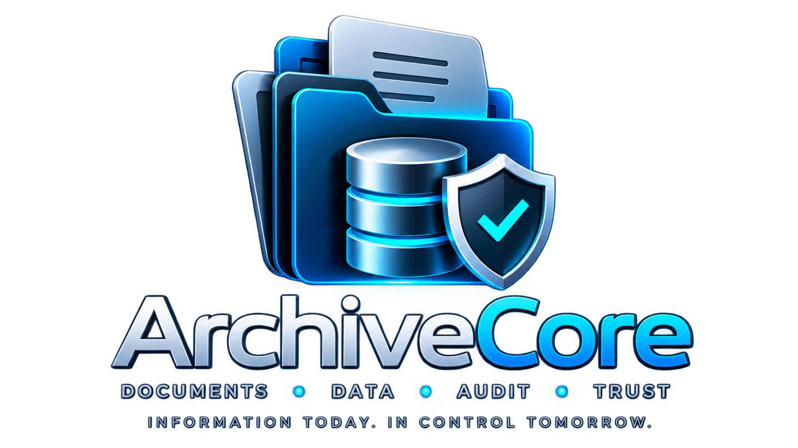

<div align="center">

<p align="center">
  
</p>

<p align="center">

</p>


<br/><br/>

<a href="https://github.com/Jairo0811/ArchiveCore/actions/workflows/ci.yml">
  
</a>

<br/><br/>

**Sistema de Gestión Documental y Expedientes**

</div>

ArchiveCore es una reconstrucción moderna de un proyecto académico desarrollado originalmente para la asignatura **Bases de Datos Avanzadas (SOF-008)** del **Instituto Tecnológico de Las Américas (ITLA)**, impartida por **Carlos Caraballos**.

El proyecto original estaba centrado en diseño y administración de bases de datos. La reconstrucción actual conserva ese origen y lo amplía hasta convertirlo en una plataforma completa para la **gestión de expedientes, documentos, versiones, movimientos, usuarios, roles y auditoría**.

ArchiveCore mantiene a **SQL Server como núcleo técnico del sistema**, incorporando una aplicación web moderna construida con **.NET 10, ASP.NET Core, React y TypeScript**.

## 🎓 Información académica

| Información | Detalle |
|---|---|
| 🏫 Institución | **Instituto Tecnológico de Las Américas (ITLA)** |
| 📖 Asignatura | **Bases de Datos Avanzadas (SOF-008)** |
| 👨‍🏫 Profesor | **Carlos Caraballos** |
| 📅 Período académico | **2017-C1** |
| 📁 Artefacto original | **Proyecto de base de datos en SQL Server** |
| 🛠️ Reconstrucción moderna | **2026** |

El trabajo académico original se enfocó en:

- Modelado conceptual y físico.
- Normalización.
- Índices.
- Consultas SQL.
- Procedimientos almacenados.
- Triggers.
- Auditoría y trazabilidad.

La reconstrucción moderna conserva esos objetivos y los integra dentro de una aplicación real de gestión documental.

## 🧭 Evolución del proyecto

El esquema original contenía conceptos iniciales como:

- `Administrador`
- `Usuarios`
- `IdArchivo`
- `IdRegistro`

En ArchiveCore estos conceptos evolucionaron a un modelo relacional completo:

| Concepto original | Evolución en ArchiveCore |
|---|---|
| `Administrador` | Usuarios + Roles + asignación de permisos |
| `Usuarios` | Gestión centralizada de usuarios |
| `IdRegistro` | Expedientes |
| `IdArchivo` | Documentos y versiones de documentos |

De esta forma, el proyecto mantiene su origen académico sin conservar las limitaciones técnicas del diseño inicial.

## 🧱 Tecnologías utilizadas

### ⚙️ Backend

<p>
  
  
</p>

- .NET 10
- ASP.NET Core Minimal API
- Entity Framework Core
- Arquitectura por capas inspirada en Clean Architecture / Onion Architecture
- Autenticación JWT
- Refresh tokens con rotación y revocación
- Hash seguro de contraseñas
- Inyección de dependencias
- OpenAPI
- Health checks

### 🎨 Frontend

<p>
  
</p>

- React 19
- TypeScript
- Vite
- TanStack Query
- React Router
- Interfaz responsive
- Dashboard administrativo
- Navegación basada en roles

### 🗄️ Base de datos

<p>
  
</p>

- Microsoft SQL Server
- Modelo relacional normalizado hasta 3NF
- Claves primarias, foráneas y alternativas
- Restricciones de integridad
- Índices orientados a patrones de consulta
- Vistas
- Procedimientos almacenados
- Transacciones
- Triggers de auditoría
- Historial de cambios mediante JSON
- Control de concurrencia con `rowversion`

## 🧩 Funcionalidades principales

### 👤 Usuarios y seguridad

- Inicio de sesión con JWT de corta duración guardado solo en memoria.
- Refresh token en cookie `HttpOnly` + `Secure` + `SameSite=Strict`, con rotación y revocación.
- Renovación automática de la sesión ante `401` (un único intento) y cierre de sesión con revocación.
- Rate limiting en login y refresh.
- Roles `Administrator`, `RecordsManager` y `User` con políticas de autorización en la API.
- Página **Usuarios** (solo Administrator): listado, alta con contraseña temporal, roles y activación/desactivación.
- Bootstrap de un solo uso del primer administrador; **no existen credenciales por defecto**.
- Política de contraseñas única y contraseñas almacenadas mediante hash.

### 📁 Expedientes

- Listado paginado con búsqueda (con debounce) por código o título.
- Filtros por estado y responsable.
- Creación, detalle y edición con control de concurrencia (`rowversion` → `409`).
- Asignación, transferencia y cierre (un expediente cerrado no admite un segundo cierre).
- Historial de movimientos con usuario origen, destino, autor y notas.

### 📄 Documentos

- Selección del expediente por código o título (sin IDs manuales).
- Metadatos, categorías y primera versión en un solo paso.
- Nuevas versiones con historial completo e identificación de la versión actual.
- Hash SHA-256 por versión para validar integridad.
- Descarga autenticada con nombre de archivo seguro y sin exponer rutas físicas.
- Allow-list de tipos validada por extensión y firma binaria; límite de tamaño configurable.
- Eliminación lógica.

### 🔄 Flujo de trabajo

- Transferencia de expedientes entre usuarios.
- Registro de usuario origen y destino.
- Notas de movimiento.
- Historial cronológico.
- Cierre y cambios de estado.

### 🛡️ Auditoría

- Auditoría automática mediante triggers de SQL Server.
- Registro de inserciones, modificaciones y eliminaciones.
- Valores anteriores y posteriores almacenados como JSON.
- Identificación del usuario que realmente ejecutó la acción (`SESSION_CONTEXT` por conexión), su IP y un `CorrelationId`.
- Consulta de auditoría (solo Administrator) por:
  - entidad,
  - registro,
  - usuario,
  - tipo de acción,
  - rango de fechas.

### 🧪 Laboratorio SQL — SOF-008

- Integración de las consultas académicas originales dentro de la aplicación moderna.
- Comparación visual entre el SQL legado y su equivalente en `ArchiveCoreDb`.
- Consultas predefinidas de solo lectura.
- Ejecución real contra SQL Server desde una sección protegida para administradores.
- Equivalencia documentada entre `Administrador` y `Users + Roles + UserRoles`.
- Equivalencia documentada entre `Usuarios` y `dbo.Users`.
- Fuente legacy canónica: `docs/legacy/DatabaseProject-original.sql`.
- El SQL Lab muestra literalmente los `SELECT` originales y no expone los datos de los `INSERT` históricos.

### 📊 Dashboard

El panel principal muestra únicamente valores reales calculados por la API (sin tendencias ni series simuladas):

- Expedientes activos.
- Expedientes cerrados.
- Documentos activos.
- Usuarios activos.
- Movimientos realizados en el día.
- Eventos de auditoría del día.

El indicador de estado se deriva del endpoint `/health` de la API.

La interfaz visual utiliza una identidad oscura en tonos navy, azul y cian, alineada con el concepto de seguridad, trazabilidad y control documental de ArchiveCore.

## 🏗️ Arquitectura del repositorio

```text
ArchiveCore/
├── database/
│   ├── 01-schema.sql
│   ├── 02-constraints.sql
│   ├── 03-indexes.sql
│   ├── 04-views.sql
│   ├── 05-procedures.sql
│   ├── 06-triggers.sql
│   ├── 07-seed.sql
│   ├── 08-queries.sql
│   ├── 09-auth.sql
│   ├── 10-validation.sql
│   └── docker/init-db.sh
│
├── .github/workflows/ci.yml
│
├── docs/
│   ├── academic/
│   ├── architecture/
│   ├── legacy/
│   ├── phases/
│   └── setup/
│
├── frontend/
│   ├── public/            (logos oficiales)
│   └── src/
│       ├── api/  auth/  components/  hooks/  layout/  utils/
│       └── pages/ (Dashboard, Records, Documents, Audit, Users, SqlLab, Login)
│
├── scripts/
│   └── docker-smoke.sh
│
├── src/
│   ├── ArchiveCore.Domain/
│   ├── ArchiveCore.Application/
│   ├── ArchiveCore.Infrastructure/
│   └── ArchiveCore.WebApi/
│
├── tests/
│   └── ArchiveCore.Api.Tests/
│
├── docker-compose.yml
├── ArchiveCore.slnx
├── ROADMAP.md
└── README.md
```

## 🧠 Arquitectura de software

El backend está organizado en cuatro capas principales:

### `ArchiveCore.Domain`

Contiene las entidades principales y reglas del dominio.

### `ArchiveCore.Application`

Define contratos, casos de uso y abstracciones de aplicación.

### `ArchiveCore.Infrastructure`

Implementa:

- acceso a datos,
- Entity Framework Core,
- SQL Server,
- seguridad,
- almacenamiento de archivos,
- servicios de expedientes,
- documentos,
- workflow,
- auditoría.

### `ArchiveCore.WebApi`

Actúa como punto de entrada HTTP y contiene:

- configuración de ASP.NET Core,
- autenticación,
- autorización,
- endpoints,
- OpenAPI,
- health checks.

## 🗄️ Orden de ejecución de la base de datos

Los scripts deben ejecutarse en este orden:

```text
01-schema.sql
02-constraints.sql
07-seed.sql
03-indexes.sql
04-views.sql
05-procedures.sql
06-triggers.sql
09-auth.sql
10-validation.sql
```

El archivo `08-queries.sql` contiene consultas de ejemplo y puede ejecutarse de manera opcional.

Con Docker este orden lo ejecuta automáticamente el servicio `db-init` (ver más abajo).

La decisión entre procedimientos almacenados y EF Core está documentada en
[`docs/architecture/data-access-strategy.md`](docs/architecture/data-access-strategy.md):
`sp_CreateRecord`, `sp_AddDocumentVersion`, `sp_TransferRecord` y `sp_CloseRecord` son la
única implementación de esas operaciones y la API los ejecuta directamente.

Para más detalles consulta:

`database/README.md`

## 🔐 Seguridad y credenciales

> **No existen credenciales por defecto.** El repositorio no contiene contraseñas, claves JWT ni
> cadenas de conexión con secretos. El primer administrador se crea con el bootstrap de un solo
> uso y los demás usuarios desde la página **Usuarios**.

Resumen del modelo:

- Access token JWT de 15 minutos en memoria; refresh token en cookie `HttpOnly` / `Secure` / `SameSite=Strict`.
- Políticas de autorización por rol en todos los endpoints; el frontend solo oculta acciones.
- Validación de entrada con `ProblemDetails` (`400`, `401`, `403`, `404`, `409`, `429`, `500`), sin stack traces ni mensajes SQL en producción.
- Uploads con allow-list, validación de firma binaria y límite de tamaño coherente entre Nginx y ASP.NET Core.
- CORS cerrado (same-origin vía Nginx / proxy de Vite), `AllowedHosts`, forwarded headers solo desde la red de Docker y cabeceras de seguridad con CSP estricta.
- Auditoría con el actor real de cada cambio.

Guía completa: [`docs/setup/security-setup.md`](docs/setup/security-setup.md).

## 🚀 Ejecución local (desarrollo)

Requisitos: .NET SDK 10, Node.js 22 y SQL Server 2019+ (o el contenedor de Docker Compose).

1. Crea la base de datos ejecutando los scripts de `database/` en el orden indicado arriba
   (o levanta solo SQL Server con Docker y deja que `db-init` lo haga: `docker compose up db db-init`).
2. Configura los secretos de la API con User Secrets (se guardan fuera del repositorio):

   ```powershell
   cd src/ArchiveCore.WebApi
   dotnet user-secrets init
   dotnet user-secrets set "ConnectionStrings:ArchiveCore" "Server=localhost;Database=ArchiveCoreDb;Trusted_Connection=True;TrustServerCertificate=True"
   # Con el SQL Server de Docker usa en su lugar:
   # "Server=localhost,1433;Database=ArchiveCoreDb;User Id=sa;Password=<ARCHIVECORE_SQL_SA_PASSWORD>;TrustServerCertificate=True"
   dotnet user-secrets set "Jwt:SigningKey" "<clave-aleatoria-de-al-menos-32-caracteres>"
   # Solo para el primer arranque:
   dotnet user-secrets set "BootstrapAdmin:Enabled" "true"
   dotnet user-secrets set "BootstrapAdmin:Email" "<tu-correo>"
   dotnet user-secrets set "BootstrapAdmin:Password" "<contraseña-que-cumpla-la-política>"
   ```

3. Inicia la API (escucha en `http://localhost:5000`):

   ```bash
   dotnet run --project src/ArchiveCore.WebApi
   ```

4. Inicia el frontend (Vite hace de proxy de `/api` y `/health` hacia la API, mismo origen):

   ```bash
   cd frontend
   npm ci
   npm run dev
   ```

5. Abre `http://localhost:5173`, inicia sesión con el administrador inicial y desactiva el
   bootstrap (`BootstrapAdmin:Enabled=false`, elimina `BootstrapAdmin:Password`).

## 🐳 Docker

El stack de Docker Compose se inicializa desde cero sin pasos manuales:

1. `db` — SQL Server 2022 con healthcheck.
2. `db-init` — servicio de un solo uso que espera a `db` *healthy*, crea `ArchiveCoreDb`,
   ejecuta los scripts en orden y termina con `ArchiveCore database validation passed.`
   En reinicios detecta la base existente y solo vuelve a validar.
3. `api` — arranca únicamente cuando `db-init` terminó correctamente; healthcheck sobre `/health`.
4. `web` — Nginx sirve el SPA y hace de proxy same-origin de `/api` y `/health`.

Volúmenes persistentes: `archivecore-sql` (base de datos) y `archivecore-documents` (archivos).

```bash
docker compose down -v          # solo si quieres empezar desde un volumen limpio
cp .env.example .env
# Edita .env: ARCHIVECORE_SQL_SA_PASSWORD, ARCHIVECORE_JWT_SIGNING_KEY y, para el primer
# arranque, ARCHIVECORE_BOOTSTRAP_ADMIN_ENABLED=true + EMAIL + PASSWORD.
docker compose up --build
```

Abre `http://localhost:5173`. Tras crear el primer administrador, pon
`ARCHIVECORE_BOOTSTRAP_ADMIN_ENABLED=false`, borra la contraseña de `.env` y reinicia `api`.

| Variable | Obligatoria | Uso |
|---|:---:|---|
| `ARCHIVECORE_SQL_SA_PASSWORD` | ✓ | Contraseña `sa` del contenedor SQL Server |
| `ARCHIVECORE_JWT_SIGNING_KEY` | ✓ | Clave HMAC del JWT (≥ 32 caracteres) |
| `ARCHIVECORE_BOOTSTRAP_ADMIN_*` | Primer arranque | Administrador inicial de un solo uso |
| `ARCHIVECORE_WEB_PORT` / `ARCHIVECORE_SQL_PORT` | — | Puertos publicados (5173 / 1433 en `127.0.0.1`) |
| `ARCHIVECORE_ALLOWED_HOSTS` | — | Hosts aceptados por la API |
| `ARCHIVECORE_REFRESH_COOKIE_SECURE` | — | `false` solo si accedes por HTTP desde un host distinto de localhost |

El stack local no termina TLS; para un despliegue real coloca un proxy HTTPS delante de `web`.

## 🧪 Pruebas y calidad

| Suite | Contenido |
|---|---|
| Backend — unitarias y smoke (xUnit) | Raíz, `401` sin token o con token inválido, JSON malformado, cabeceras de seguridad y `CorrelationId`, CORS, política de contraseñas, inspección de tipos de archivo y nombres seguros. |
| Backend — integración con **SQL Server real** (Testcontainers) | Scripts `01`–`10` sobre una base limpia; health, login válido/inválido, rate limiting, refresh, revoke, `401`/`403` por rol, expedientes (duplicado, edición con `rowversion`, transferencia, cierre doble), documentos, versiones, hash, descarga, eliminación lógica, auditoría y actor correcto, SQL Lab solo para Administrator. |
| Frontend (Vitest + Testing Library) | Login, rutas protegidas, permisos por rol, refresh único ante `401`, logout con revocación, estado de error con reintento, estado vacío, formato de fechas. |
| Docker smoke (`scripts/docker-smoke.sh`) | Arranque desde volumen limpio y flujo completo a través de Nginx: login → refresh → alta de RecordsManager → expediente → documento → versión de 5 MB → descarga → asignación → cierre → auditoría → SQL Lab → logout. |

GitHub Actions (`.github/workflows/ci.yml`) ejecuta en cada push:

- `dotnet restore` / `build -c Release -warnaserror` / `test` (incluye SQL Server real).
- `npm ci`, `npm run lint`, `npm run build`, `npm test`.
- Escaneo de dependencias: NuGet vulnerable (incluye transitivas) y `npm audit`; falla ante High/Critical sin excepción documentada.
- `docker compose config`, `docker compose build`, arranque limpio, validación SQL, smoke end-to-end y reinicio conservando volúmenes.

Comandos locales:

```bash
dotnet test ArchiveCore.slnx -c Release      # las pruebas de integración requieren Docker
cd frontend && npm run lint && npm run build && npm test
```

## 🗺️ Fases de reconstrucción

ArchiveCore fue reconstruido en las siguientes fases:

1. Análisis del legado y fundación del proyecto.
2. Rediseño y normalización de la base de datos.
3. SQL Server avanzado.
4. Fundación del backend .NET.
5. Identidad y control de acceso.
6. Expedientes y documentos.
7. Workflow y movimientos.
8. Auditoría y trazabilidad.
9. Aplicación web en React.
10. Calidad, Docker y endurecimiento para portafolio.

El detalle completo se encuentra en:

`ROADMAP.md`

## 🎯 Estado final

**ArchiveCore v1.0.0 — FROZEN — PORTFOLIO RELEASE.**

La versión final pasó por una fase de *hardening / release candidate* que corrigió errores,
completó en la interfaz las funciones que el backend ya ofrecía (expedientes, documentos,
versiones, workflow, auditoría y usuarios), endureció seguridad y sesiones, unificó la interfaz
en español y saneó el repositorio público.

Cada commit de `main` se valida en GitHub Actions con: build Release, pruebas unitarias,
pruebas de integración sobre SQL Server real, lint, build y pruebas del frontend, escaneo de
dependencias y arranque de Docker desde un volumen limpio con smoke test end-to-end.

Limitaciones conocidas (deliberadas para un proyecto académico de portafolio):

- El stack Docker local no termina TLS; un despliegue público necesita un proxy HTTPS delante.
- No hay prueba E2E en navegador (Playwright); el flujo completo se valida con el smoke test
  HTTP a través de Nginx y con las pruebas de componentes del frontend.
- `npm audit` mantiene una excepción documentada para una advisory sin parche que solo afecta
  herramientas de desarrollo (ver [`docs/setup/security-setup.md`](docs/setup/security-setup.md#dependencias)).

## 🧊 Estado de mantenimiento

**ArchiveCore está congelado como proyecto académico restaurado para portafolio.**

| Referencia | Valor |
|---|---|
| Versión | `v1.0.0` |
| Rama congelada | `release/archivecore-v1.0.0-frozen` (apunta al mismo commit que `main`) |
| Estado | `FROZEN — PORTFOLIO RELEASE` |

No existe desarrollo activo planificado. Solo debería modificarse ante correcciones críticas,
ajustes de seguridad, problemas de compatibilidad o una decisión explícita de reabrir el proyecto.
La evolución histórica se conserva en las ramas de fase y en la documentación del repositorio.

## 🧭 Continuidad académica

ArchiveCore comparte profesor con [**SalesIntel-DW**](https://github.com/Jairo0811/SalesIntel-DW).

Ambos proyectos fueron desarrollados bajo la docencia de **Carlos Caraballos**, aunque corresponden a asignaturas y objetivos diferentes.

| Orden | Asignatura | Proyecto | Período |
|---:|---|---|---|
| 1 | Bases de Datos Avanzadas (SOF-008) | **ArchiveCore** | 2017-C1 |
| 2 | Minería de Datos e Inteligencia de Negocios (SOF-014) | [**SalesIntel-DW**](https://github.com/Jairo0811/SalesIntel-DW) | 2017-C3 |

La relación entre ambos repositorios es exclusivamente **académica y docente**.

---

<div align="center">

**ArchiveCore — Información segura, trazable y bajo control.**

Proyecto académico reconstruido para portafolio.

</div>
